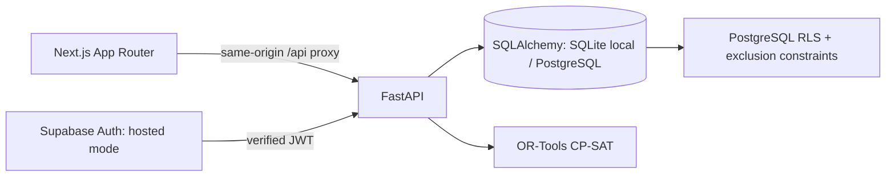

# SHIFT architecture

## Repository assessment (2026-11-06)
Origin is https://github.com/jordanantonio/amuse.git. Local main and origin/main
were both f59048b, the initial commit, with only README.md and LICENSE. A read-only
remote-ref inspection found only main. No application, dependencies, CI, existing
AGENTS.md, or branch policy was present. Work begins on codex/shift-foundation;
main is unchanged and nothing is pushed. System PATH initially lacked Node/npm;
Python 3.12 and uv were available. Use documented standard toolchains below.

## Components

Next.js uses TypeScript, Tailwind, Lucide icons, and accessible composable UI
primitives. The dashboard fetches FastAPI data, with refresh after writes and
periodic polling. Next rewrites /api/v1/* to the backend; no browser secret keys.
FastAPI validates requests and returns typed Pydantic responses/OpenAPI. SQLAlchemy
2 models work with SQLite for local setup and PostgreSQL for Supabase. Alembic
owns schema migrations; seed code is a separate idempotent development operation.

## Model boundaries
| Entity | Purpose |
| --- | --- |
| Organization, Membership | Tenant and role scope; verified auth subject binding |
| Worker, Skill, Certification | Searchable professional profile and qualifications |
| AvailabilityWindow | Worker-published available slots |
| PrivateCommitment | Private blocker; serialize only start/end when appropriate |
| Project, Task, TaskDependency | Deadlines, duration, capacity, skill demand, DAG |
| Assignment | Confirmed work and historical disruptions; never draft proposals |
| JobPosting, Application | Company demand and worker-initiated applications |
| ScheduleDraft | Immutable input fingerprint, solver result, proposed placements |
| Invitation | Explicit offer lifecycle before confirmed assignment |
| AuditEvent | Actor, action, entity, timestamp; no private calendar payloads |

All instants are timezone-aware at API boundaries, stored in UTC. UI displays
America/Edmonton. Intervals are half-open [start, end). Integer CAD cents avoid
float money; solver uses hourly discrete slots in the first demo. Non-aligned
commitments block every slot they intersect. Qualifications must remain valid
through the end of the assignment. SQLite lacks production exclusion constraints. PostgreSQL now has a confirmed-worker
range exclusion constraint; acceptance must still add transactional revalidation and locking.

## Authorization and privacy
Foundation local mode uses a conspicuous demo-persona header and explicitly
requires loopback/local deployment. This is a role-policy testing harness, not
login. API checks tenant and role; worker endpoints return own schedule. Managers
get published availability, relevant workforce profiles, and opaque busy windows.
Private titles/reasons are never serialized into dashboard responses.
Hosted mode verifies Supabase JWTs and membership mappings and requires RLS with
restricted runtime credentials. Assignment creation remains unavailable until
approval/acceptance transactions and their concurrency tests are implemented. Never ship a public demo
identity override or put a service-role key in browser code. Runtime DB credentials
must be server-only. RLS and identity now have local PostgreSQL tests; configuring and verifying the
actual Supabase project remains an integration gate.

## Solver contract
Input: organization/project scope, fixed confirmed assignments across projects,
workers and dated skills/certifications, published availability, private busy
intervals, task duration/dependencies/crew size, site capacity, deadlines, budget.
An LLM is not in this path. CP-SAT optional intervals represent eligible worker,
task, and start combinations. Exactly required crew placements per unstaffed task;
shared task start; NoOverlap per worker including fixed commitments; cumulative
site capacity; precedence; project deadline; labour budget. Minimize illustrative
planned labour cents and start times. No speed/savings claims are precomputed.
Existing confirmed assignments are fixed; the disruption action must be explicit.
Return OPTIMAL/FEASIBLE with proposals, INFEASIBLE with candidate eligibility and
resource/deadline blockers, or UNKNOWN with a timeout explanation. Diagnostics are
prechecks and model constraints, not an alleged minimal unsatisfiable core.
Partial fixed crews, multi-day shifts, breaks, travel, and legal overtime rules
require dedicated modeling; unsupported inputs must be reported, never ignored.

## Foundation API (v1)
- GET /health — runtime mode; GET /personas — local demo only
- GET /me — verified membership/organization identity (or explicit local persona)
- GET /dashboard — role-scoped projects, workforce/own profile, assignments, jobs
- POST /projects/{id}/draft — manager/admin only; CP-SAT draft persisted separately
- POST /assignments/{id}/disrupt — manager/admin, explicit confirmed→disrupted
- GET /drafts — scoped persisted proposals; never confirmed work
- POST /demo/reset — demo admin only; fixture reset, never production
Later contracts: profile/availability/project/task/job CRUD; applications;
POST /drafts/{id}/approve; invitations accept/decline; revision/ETag conflict (409).
Export OpenAPI via scripts/export_openapi.py. Frontend types mirror response models.

## References
- [Next.js installation](https://nextjs.org/docs/app/getting-started/installation)
- [OR-Tools employee scheduling](https://developers.google.com/optimization/scheduling/employee_scheduling)
- [Supabase RLS](https://supabase.com/docs/guides/database/postgres/row-level-security)
- [Supabase Auth](https://supabase.com/docs/guides/auth)

## Foundation implementation notes

The frontend calendar and project cards are separate components; workspace.tsx
coordinates persona/view state and mutations. UI primitives are locally owned
shadcn-style components (CVA, clsx, tailwind-merge), not a claim that every shadcn
component is installed. Both dev and build select Webpack because Turbopack's CSS
subprocess is restricted in the current executor. Lockfiles pin tested resolutions.

`worker_absences` stores explicitly manager-recorded unavailability independently
of private commitments. The demo disruption action clearly scopes absence to the
project week, retains the disrupted assignment, and writes an audit event. It does
not cancel other confirmed work: if another commitment conflicts with the recorded
absence, the solver reports infeasibility rather than silently moving that work.

The initial absence and draft endpoints are synchronous local-demo operations.
They do not claim the production transactional reservation or optimistic-concurrency
guarantees required for approval/acceptance. Add these before exposing assignment
creation. The input fingerprint is persisted now for that follow-up lifecycle.

## Identity and database safety implementation

Hosted startup requires PostgreSQL, an HTTPS Supabase issuer, and a restricted
non-owner/non-bypass runtime role in shift_app. Demo mode defaults off and requires
an explicit local environment. The demo launcher enables it; hosted startup never
migrates or seeds. GET /api/v1/me returns identity and organization, without auth
subjects. Bearer JWT verification permits ES256/RS256 and validates signature,
issuer, audience, expiry and required claims through the issuer's cached JWKS.

Database transaction begin installs the verified subject with set_config(..., true),
including after commit. RLS helpers resolve membership without trusting token roles.
Private-label rows stay owner-only; safe definer projections supply opaque busy
intervals and cross-project site occupancy to dashboard/solver. Application writes
are limited to current draft/disruption/audit operations; no assignment insert or
approval privileges are granted yet. A GiST exclusion constraint protects confirmed
worker intervals across projects. Migration/provisioning credentials stay separate.

The browser uses the Supabase client for password sign-in and refresh, then sends
bearer tokens through the same-origin API proxy. Session expiry unmounts workspace
data. Hosted UI removes persona switching/reset and derives week dates from API
data. Actual Supabase integration and hosting remain configuration-dependent; see
HOSTED_SETUP.md and TESTING.md. These notes supersede the historical foundation
statements above that identity/RLS were unimplemented.
